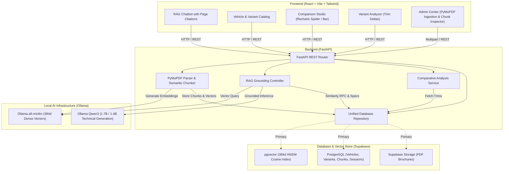

# AutoMate AI – Enterprise Automotive Intelligence Platform

AutoMate AI is a production-grade, full-stack automotive AI assistant. It empowers car buyers, automotive engineers, and dealership administrators to interact with an AI assistant grounded strictly in OEM PDF brochures and structured vehicle engineering specifications.

The application features a modern Dark Navy automotive console design, grounded RAG Q&A with exact document and page-level source citations, a vehicle specification catalog, an engineering comparison studio with Recharts radar spider charts, a variant analyzer, and an admin brochure ingestion center.

---

## Architecture



---

## Key Modules & Capabilities

1. **Grounded RAG AI Assistant**:
   - Answers questions strictly using verified brochure passages and structured vehicle specs.
   - Anti-hallucination prompt control: Explicitly refuses to invent specifications not found in the context.
   - Interactive Citation Badges: Clicking `[Doc: <name>, Page: <page>]` displays the verified PyMuPDF text passage and exact page number.
   - Multi-turn conversation history with session tracking.

2. **Automotive Catalog & Spec Explorer**:
   - Filter vehicles by category (Electric, Gasoline, Hybrid) and body style (Sedan, SUV, Truck).
   - High-fidelity vehicle cards with price ranges, max horsepower, and trim counts.
   - Detailed modal displaying full engineering trims, safety ratings, dimensions, and standard equipment.

3. **Comparison Studio**:
   - Side-by-side technical evaluation of 2 to 4 vehicles simultaneously.
   - Interactive Recharts Spider/Radar chart evaluating Performance, Torque, Efficiency, Dynamics, and Utility.
   - Recharts Bar Chart comparing peak horsepower and torque.
   - Comprehensive comparative engineering specification table.
   - AI Winner Highlights automatically summarizing leaders in power and affordability.

4. **Variant Analyzer**:
   - Compare specific trim packages of the same vehicle (e.g., Porsche Taycan Base vs 4S vs Turbo S, or BMW 330i xDrive vs M340i xDrive).
   - Evaluate performance step-ups and pricing deltas.

5. **Admin Center & PDF Ingestion**:
   - Drag-and-drop OEM PDF brochure uploader.
   - Real-time ingestion pipeline: PDF upload -> PyMuPDF page extraction -> Semantic chunking with overlap -> Ollama 384d embeddings -> pgvector storage.
   - Chunk Inspector: Search and review extracted brochure passages by page number.

---

## Technology Stack

- **Frontend**: React 18, Vite, Tailwind CSS, React Router, Axios, Lucide React, Recharts.
- **Backend**: Python 3.13, FastAPI, Pydantic v2, PyMuPDF (fitz).
- **Database**: Supabase PostgreSQL with `pgvector` (384 dimensions) and Supabase Storage.
- **Local AI**: Ollama running locally (`all-minilm` for embeddings, `qwen3:1.7b` for text generation). **Zero paid API keys required**.

---

## Quickstart Guide

### Prerequisites
1. **Ollama**: Ensure [Ollama](https://ollama.com/) is installed and running:
   ```bash
   ollama pull all-minilm
   ollama pull qwen3:1.7b
   ```
2. **Python**: Python 3.11+ (Tested on Python 3.13).
3. **Node.js**: Node.js v18+ (Tested on Node.js v24).

### 1. Backend Setup
```bash
# Navigate to backend directory
cd backend

# Create virtual environment (optional)
python -m venv venv
# Windows:
venv\Scripts\activate
# Linux/macOS:
source venv/bin/activate

# Install dependencies
pip install -r requirements.txt

# Configure environment variables
# Copy .env.example to .env
copy .env.example .env

# Generate realistic test PDF brochures (optional)
python scripts/generate_sample_brochures.py

# Run FastAPI backend server
uvicorn app.main:app --reload --host 0.0.0.0 --port 8000
```
Backend API interactive documentation is available at: `http://localhost:8000/docs`.

### 2. Frontend Setup
```bash
# Navigate to frontend directory
cd frontend

# Install dependencies
npm install

# Start development server
npm run dev
```
Open `http://localhost:5173` in your browser.

---

## Supabase PostgreSQL & pgvector Setup

If connecting to a Supabase Cloud instance or local Supabase PostgreSQL:

1. Open your Supabase Project -> **SQL Editor**.
2. Run the migration scripts in sequence from `backend/sql/`:
   - `01_schema.sql` (Creates `uuid-ossp`, `vector`, `vehicles`, `variants`, `documents`, `document_chunks`, `chat_sessions`, `chat_messages`).
   - `02_pgvector_search.sql` (Creates HNSW cosine distance index and `match_document_chunks` RPC procedure).
   - `03_seed_data.sql` (Seeds realistic Porsche Taycan, BMW 3 Series, Hyundai Ioniq 5, Ford F-150 Lightning specifications).
3. In Supabase Storage, create a public or private bucket named `brochures`.
4. Copy your project URL and Service Role Key into `backend/.env`:
   ```env
   SUPABASE_URL="https://your-project.supabase.co"
   SUPABASE_SERVICE_ROLE_KEY="your-supabase-service-role-key"
   ```
*Note: If Supabase credentials are left blank, AutoMate AI runs in local persistent fallback mode automatically.*

---

## Running Automated Tests

Run the backend unit test suite:
```bash
# Set PYTHONPATH to backend directory
# Windows PowerShell:
$env:PYTHONPATH="backend"; python -m unittest backend/tests/test_health_unittest.py backend/tests/test_database.py backend/tests/test_vehicles.py backend/tests/test_pdf_processor.py backend/tests/test_embeddings_and_search.py backend/tests/test_comparison.py backend/tests/test_rag_chat.py -v
```

---

## Security & Architectural Guarantees

- **No Public Ollama Exposure**: Ollama runs strictly on `127.0.0.1:11434` and communicates only with FastAPI.
- **No Leaked Service Keys**: Supabase service keys are handled exclusively in backend environment variables and are never sent to the React client.
- **Deterministic Grounding**: Every brochure citation specifies both the source document name and the 1-indexed page number.
